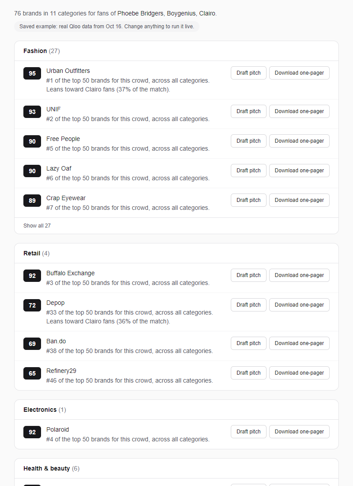
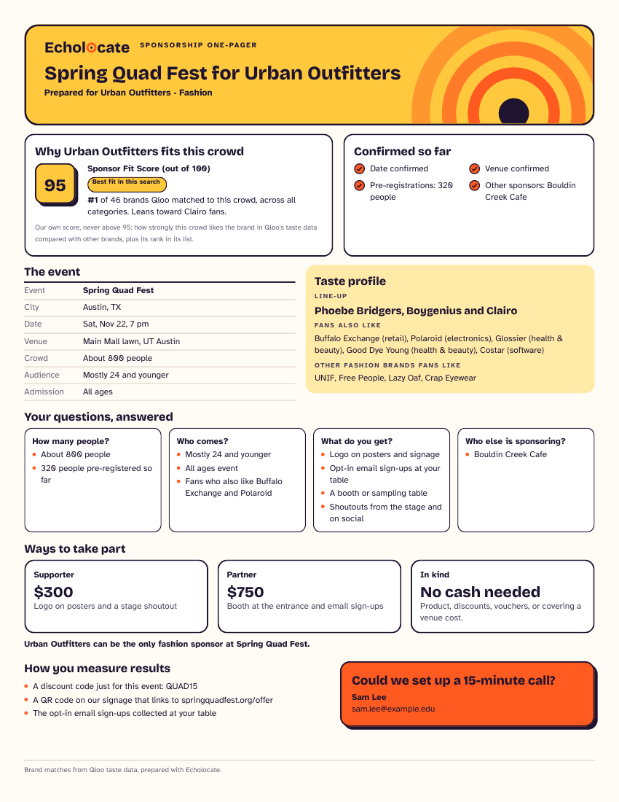

# Echolocate

**Sponsors for events too small to have a sponsorship team.**

Echolocate finds sponsors for small events (campus shows, community gigs) by asking Qloo which brands and local businesses the event's crowd already likes, then drafts the pitch email and a one-page sponsor sheet.

Most events are small. In 2024, Eventbrite creators alone hosted nearly 5 million events and issued 270 million tickets ([Eventbrite Form 10-K](https://www.sec.gov/Archives/edgar/data/1475115/000147511525000026/eb-20241231.htm)), about 55 tickets per event. Big tours have sponsorship teams; events this size don't, and they have no sponsor history to copy.

**Live demo:** https://echolocate-topaz.vercel.app/

> Your event isn't in Qloo, but the music on your line-up is. Your line-up and city in; ranked sponsors, a pitch email and a one-page sponsor sheet out.

### Try it in 60 seconds (no sign-up)

1. Click **Try an example**: a 150-person 21+ bar gig in Athens, GA with local bands Qloo doesn't know, so it searches by genre. Local sponsors come first, on a map. The link under it runs a bigger campus show in Austin, TX (800 people, with Phoebe Bridgers, boygenius and Clairo), where the reasons name the artists. Both are answered instantly from saved, real Qloo answers.
2. Scan the brands by category: each has a Sponsor Fit Score and the reason from Qloo's data.
3. Click **Draft pitch** on any brand or local place, then **Make one-pager** and **Download PDF**.
4. Scroll to **How the agent got this**: the decisions the agent took, and every Qloo request with its parameters.





Built for the Qloo Agentic Hackathon.

## What it does

The organizer enters the kind of music (or artists on the line-up), the city, who mostly comes, who is allowed in (all ages, 18+ or 21+) and the expected crowd. Echolocate then:

1. ranks brands per category for that crowd, each with a Sponsor Fit Score and a plain reason,
2. shows local cafes, clothing stores and (for 21+ events) bars on a map,
3. drafts a pitch email for any brand or local place,
4. makes a one-page sponsor PDF in the browser.

## Why this is an agent

Given one goal, "find sponsors for this event", Echolocate plans and runs the Qloo calls itself, adapts when an answer is empty or thin, stops to ask when a choice would change the result, checks the language model's output, and hands back work the organizer can use: a ranked list, an email and a PDF. It never sends anything; the organizer edits and sends.

- **Resolves vague input into Qloo IDs, and asks when unsure.** Artist names go to `/search`; only an exact name match is used. Anything else is shown back as candidates to pick from, because a search for "Wishy" returns "Wish You Were Here". A genre not on our checked list is looked up with `/v2/tags`, and the page says which Qloo tag it became.
- **Adapts to the answers.** If Qloo has no taste data for the city, it asks again for the line-up alone and says so. If fewer than 6 local places come back, it widens the search radius once. For a crowd of 200 or fewer it puts local businesses first.
- **Applies fixed rules the model cannot override.** Alcohol brands and bars only for 21+ events; advocacy groups and institutions are removed. All on the server.
- **Checks the language model.** The model only writes the email body, from a fixed list of facts. A plain code check throws the draft away for a template if it adds a number that is not in the facts, calls a local place a "venue", or claims a "perfect fit", and the page says why.
- **Shows its work.** Under every result, "How the agent got this" lists what it decided for that search and each Qloo request with its parameters and result count.

## How the agent works

Every Qloo call is listed in the app under "How the agent got this", with its result count.

1. **Genre.** A genre picked from the list already has its Qloo tag id (`src/data/music-genres.json`), so no call is needed. A typed genre is looked up with `GET /v2/tags` (`filter.query`), and the app says which Qloo genre it matched.
2. **Artists (optional).** Each name goes to `GET /search` (`query`, `types=urn:entity:artist`). Only an exact name match is used. Otherwise the app asks the organizer to pick the right artist, because a search for "Wishy" can return "Wish You Were Here".
3. **Brands.** `GET /v2/insights` with:
   - `filter.type=urn:entity:brand`
   - `signal.interests.entities` (artist ids) and `signal.interests.tags` (genre tag)
   - `signal.location.query` (the city) and `signal.demographics.age`
   - `feature.explainability=true`

   One call returns the top 50 brands across all categories. One call per sponsor category adds `filter.tags`: drinks and financial services, plus beer and spirits for 21+ events only. If a city returns nothing at all, the calls run again without the city, and the app says so.
4. **Rules, applied on the server.**
   - Alcohol brands (any `wine_and_spirits` tag) and bars only for 21+ events.
   - Advocacy groups that come back as "brands" are dropped, and so are big institutions that will not sponsor a small show: sports teams, universities, museums and news outlets (by their Qloo tags).
   - Qloo's audience segments (`urn:audience`) are never used or shown.
5. **Score and reason.** The Sponsor Fit Score is our own score, not a Qloo number. It is never above 95.
   - **Brands** are compared with the other brands for the same crowd. Score = 40 + 55 × (0.8 × the brand's affinity percentile among all brands of the search + 0.2 × its rank in its list). Every category is in one pool, so a weak category's #1 does not look perfect, and it gets a note saying the category is a smaller fit.
   - **Local places** are scored the same way, against the other places of the search, but only places Qloo has taste data for take part. With fewer than 5 such places, they use a fixed scale instead (80% affinity, 20% rank). When Qloo has little taste data for a place (its affinity sits at Qloo's default value), the place gets no score. It is listed after the scored places, nearest first, as "Nearby · little taste data". Its pitch email talks about being nearby, the crowd and the offer, and never says the crowd likes the place.

   The reason starts from the rank. It names an artist only when that artist's share of Qloo's explainability is clearly higher than the others'.
6. **Local places.** `GET /v2/insights` with:
   - `filter.type=urn:entity:place`
   - `filter.tags` (cafe, clothing store, bar)
   - the same signals as for brands
   - `filter.location=POINT(lon lat)` and `filter.location.radius` for a US city picked from the list. The radius is 5, 10 or 15 km by the city's population. With fewer than 6 places, the search runs once more with twice the radius (at most 30 km).

   A city typed by hand uses `filter.location.query` instead.
7. **Pitch email.** A language model (through OpenRouter, or DeepSeek's own API) writes the email from a fixed list of facts: the brand, the rank and reason from Qloo, and the event details. Anything it does not know stays in [square brackets]. Without a key, or when the model is busy or fails, a built-in template writes it, and the app says which one was used.
8. **One-pager.** Built in the browser with `@react-pdf/renderer` from the same facts. Optional details the organizer adds (date, venue, tiers, discount code) fill the brackets. Items under "Confirmed so far" appear only when the organizer ticks them as confirmed.

### Qloo features used, and why

| Qloo feature | Used for | Why it fits |
|---|---|---|
| `GET /search` (`types=urn:entity:artist`) | The artists on the line-up | Turns names into Qloo entities; exact match only, else the organizer picks |
| `GET /v2/tags` (`filter.query`) | A typed genre | Small local acts are often not in Qloo, but their genre is |
| `GET /v2/insights`, `filter.type=urn:entity:brand` | One list across all categories, then one per sponsor category (`filter.tags`) | The taste question: which brands fans of this music like |
| `signal.interests.entities`, `signal.interests.tags` | Artists and genre as the signal | The event is not in Qloo; its music is |
| `signal.location.query`, `signal.demographics.age` | City and age group of the crowd | Qloo's lists change with the city (tested); the age group narrows the crowd |
| `feature.explainability=true` | The reason line ("Leans toward Clairo fans") | Says which part of the line-up drives a match |
| `filter.type=urn:entity:place`, `filter.location=POINT(lon lat)`, `filter.location.radius` | Cafes, clothing stores and bars near the event | Local businesses are the likeliest sponsors of a small show; the radius works (tested) |

We call the Qloo REST API from Next.js server routes. The `qloo mcp` server in Qloo's hackathon kit cannot run on serverless hosting, and this app runs on Vercel.

### Request to result: one real example

From the saved campus example (the API key is never part of a request or a log):

1. `GET /search?query=Clairo&types=urn:entity:artist&take=3` returns 3 results; the exact match "Clairo" is used. The same for Phoebe Bridgers and boygenius.
2. `GET /v2/insights?filter.type=urn:entity:brand&signal.interests.entities=<the 3 artist IDs>&signal.location.query=Austin, TX&signal.demographics.age=24_and_younger&feature.explainability=true&take=50` returns 50 brands.
3. Two more calls of the same kind, with `filter.tags=urn:tag:genre:brand:food_and_beverage:drinks` and with `filter.tags=urn:tag:genre:brand:financial_services`, return 15 brands each. Beer and spirits are not asked for: the event is all ages.
4. Rules on the server remove 5 of the brands Qloo returned: 3 advocacy groups, 1 news outlet and 1 drinks brand that Qloo tags as alcohol. 75 brands are left.
5. Urban Outfitters is #1 of the 46 brands left in the cross-category list. Explainability splits its match 37% Clairo, 34% Phoebe Bridgers and 30% boygenius, so the reason says "Leans toward Clairo fans". Its Sponsor Fit Score is 95, the best in this search.
6. "Draft pitch" sends the rank, the reason and the event details to the language model, and the code check above decides whether its draft is used.

Every request of a search, with its parameters, is shown in the app under "How the agent got this", then "Show every Qloo request".

## Data handling

- Sent to Qloo: artist names, a genre, the city and an age group. Never a name, an email or anything else personal.
- Sent to the language model, only when "Draft pitch" is clicked: the brand or place, its rank and reason from Qloo, and the event details the organizer typed (event name, city, crowd size, age group, admission).
- Qloo's audience segments (`urn:audience`) are never used or shown.
- API keys stay on the server. The saved examples keep only the fields the app reads.
- Qloo results describe what fans of the music like as a group. The app does not use them to say anything about a person.

## Why Qloo, not just a language model

Qloo picks the sponsors: which brands and local places, in what order, and why. The language model only writes the email from the facts it is given, and it may not add numbers, prices, dates or sponsors of its own. Without Qloo there is no list and nothing to pitch.

We also asked an AI model, without Qloo, to name sponsors for the same 10 festivals. It scored higher (41% of real sponsors in its top 10, against 25% for Qloo). But it also named 9 of the 10 festivals from the line-up and city alone, so it was largely remembering past sponsors. A campus show or a community gig has no sponsor history to remember, and that is the case Echolocate is built for. Full results: [backtest-llm/results.md](backtest-llm/results.md).

## What we tested

**Backtest on 10 US festivals** (`backtest/results.md`; run it again with `node --env-file=.env.local backtest/run.mjs`). For each real sponsor found in Qloo, we checked its rank in Qloo's list for that festival's headliners and city.
- At the product-category level (the level the app uses), 25% of 129 sponsors were in the top 10, against 17% for a control: the same brands at festivals they did not sponsor.
- At the broad-category level it was 13% against 7%.
- The edge was small. At Bonnaroo we found 0 of 12 sponsors in the top 10.
- These were large festivals; small events have no public sponsor lists to test against.

**Probes of the Qloo API** (`scripts/probe-*.mjs`):
- **Places.** `filter.location=POINT(lon lat)` with a radius worked in our tests: with a 3 km radius, every cafe came back within 2.7 km. With a city name, the radius was ignored.
- **Brands.** A location given as a point barely changed the results in our tests. The top five were almost the same as with no location at all. So brands use the city name.
- **Cities without data.** Some cities return no brands at all, with no error. Indio, CA returned 0. The app then matches on the line-up alone and says so.
- **Scores.** A fixed affinity scale worked for artist line-ups but not for genres. Genre searches put top brands at an affinity of 0.97 to 1.00, so every genre search showed a wall of 95s. So brands are now scored against each other within a search. On six test searches (Austin, Atlanta, Las Vegas, Ithaca, Los Angeles, Toronto), the median brand score was 65 to 68, with at most one brand at 95. Places, scored the same way, had medians of 66 to 70 and one place at 95.
- **Places with little data.** In those tests, 89 of 154 places came back with the same affinity, 0.765, Qloo's default. In Ithaca, NY that was every place.

## Limitations

- **What a result does not establish.** A high Sponsor Fit Score means fans of this music like the brand, compared with the other brands Qloo found for the same search. It does not mean the brand sponsors events, has a budget, or will say yes. The pitch email and the one-pager are drafts for the organizer to check and send.

- **Cities without Qloo data** get brands matched to the line-up alone.
- **Small local artists** are often not in Qloo. The genre field covers them, and artist names are optional.
- **City suggestions** cover US places from Census data (5,000+ people, plus small campus towns). Other cities can be typed, but brands then use the plain city name and places use the old city-name search.
- **The Sponsor Fit Score is ours.** A brand's score says how it compares with the other brands for the same crowd, not how good a match it is in absolute terms. Scores from two different searches should not be compared.
- **Small towns often have little place data.** Places there may have no score and are sorted by distance.
- **Big banks stay in the list.** Qloo tags them like any other financial service (Chime, Venmo), so they cannot be filtered by tag.
- **The PDF covers Western European letters only.** Its fonts (Bricolage Grotesque, Atkinson Hyperlegible) are the Latin subsets, so other accents are dropped ("Allē" prints as "Alle"), and non-Latin scripts are not supported.
- **The demo's limits are kept in memory**, per server instance. They are not exact across a whole deployment.
- **The saved examples are snapshots** from 16 Oct 2026 (campus) and 30 Oct 2026 (bar gig). Live searches use current data.

## Run it locally

Needs Node.js 20.9 or newer.

```bash
npm install
npm run dev
```

Open http://localhost:3000.

- **Without any keys:** both saved examples work (campus show and bar gig), and pitches use the template.
- **With keys:** copy `.env.example` to `.env.local` and fill in:
  - `QLOO_API_KEY` for live searches,
  - for written pitches (optional): an OpenRouter key as `LLM_API_KEY` (or `OPENROUTER_API_KEY`) and `LLM_MODEL`, any OpenRouter model id (a free `:free` model works for testing; set a paid one later, no code change). Or `DEEPSEEK_API_KEY` for DeepSeek's own API (`DEEPSEEK_MODEL` defaults to `deepseek-flash`). If the model hits its rate limit or fails, the pitch falls back to the template.

`npm run lint` checks the code. `npx tsc --noEmit` checks types.

### Limits on the public demo

So that one visitor cannot use up the Qloo quota:
- 15 live searches per IP per 10 minutes, and 60 per day,
- 600 live Qloo calls per day in total,
- the saved examples never count.

**To pause all live searches** (the example keeps working), set the environment variable `QLOO_LIVE=off`:
- **Vercel:** Project → Settings → Environment Variables, add `QLOO_LIVE` = `off`, then redeploy. Remove it and redeploy to switch live search back on.
- **Locally:** add `QLOO_LIVE=off` to `.env.local` and restart `npm run dev`.

### Re-recording the saved examples

The two examples (`campus` and `bar`) are answered from saved real Qloo responses in `src/data/demo/qloo-recording.json`, so they are instant and make no Qloo calls. Only the fields the app reads are kept. To record one again (about 8 Qloo calls), on Windows PowerShell:

1. Stop the dev server, then start it in record mode, naming the example:
   `$env:QLOO_RECORD="1"; $env:QLOO_RECORD_EXAMPLE="bar"; npm run dev`
2. In a second terminal, from the project root:
   `node scripts/record-demo.mjs bar`
3. Stop the dev server. **Then close that terminal, or run `Remove-Item Env:QLOO_RECORD; Remove-Item Env:QLOO_RECORD_EXAMPLE`.** While `QLOO_RECORD` is set, every search runs live and is recorded.
4. Start the dev server normally (`npm run dev`) and check that the example shows "Saved example".

## Stack

Next.js 16 (App Router), React 19, TypeScript, Tailwind CSS 4, Leaflet with OpenStreetMap tiles, `@react-pdf/renderer`. Deployed on Vercel. City data: US Census Bureau (public domain).

## License

MIT. See [LICENSE](LICENSE).
